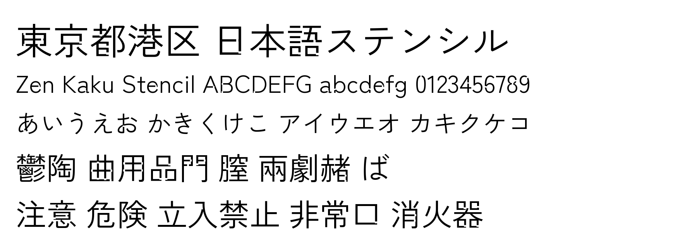
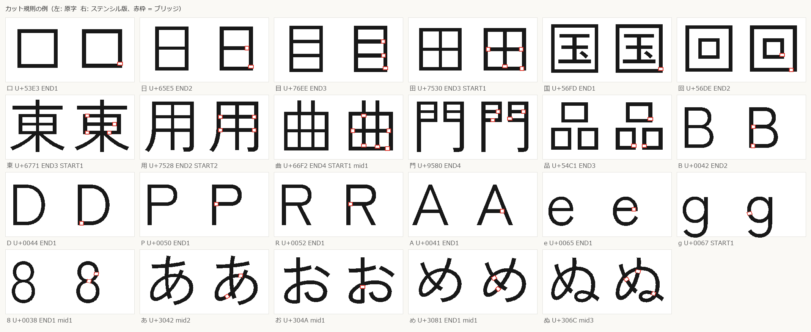
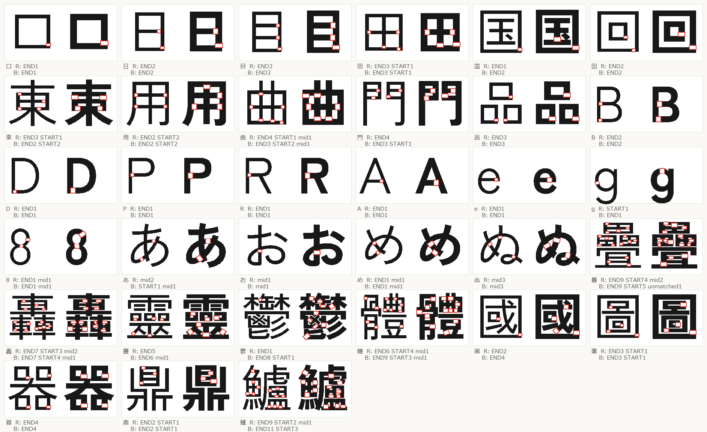
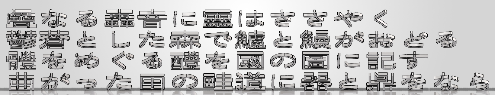
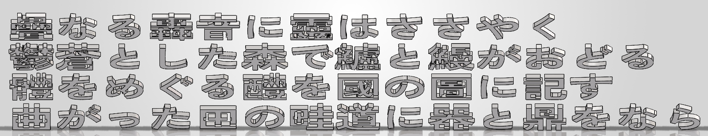

# Zen Kaku Stencil

漢字を含む 7,792 字を、CAD でそのまま切り抜ける日本語ステンシルフォント。
A Japanese stencil typeface, kanji included, that cuts cleanly in CAD.

**ダウンロード / Download:**
[ZenKakuStencil-Regular.ttf](https://github.com/klxuyfk/zen-kaku-stencil/raw/main/fonts/ttf/ZenKakuStencil-Regular.ttf) ・
[ZenKakuStencil-Bold.ttf](https://github.com/klxuyfk/zen-kaku-stencil/raw/main/fonts/ttf/ZenKakuStencil-Bold.ttf) ・
[zip（両ウェイト + ライセンス）](https://github.com/klxuyfk/zen-kaku-stencil/releases/latest)

Regular / Bold ・ 7,792 glyphs（漢字 6,682、かな、ラテン、記号）・ SIL Open Font License 1.1 ・ [Zen Kaku Gothic New](https://github.com/googlefonts/zen-kakugothic) の派生



[日本語](#日本語) / [English](#english)

---

## 日本語

### 1. なぜこのフォントが必要か

板から文字を切り抜くと、口・日・田・B のような閉じた形の内側は支えを失って抜け落ちる。ステンシル書体は、内側を細い橋（ブリッジ）で外側につないで切り抜けるようにした書体で、看板、刻印、治具の銘板、レーザー加工、3D プリントの文字入れなど、文字を印刷するのではなく製作する場面で使われる。

漢字を含む日本語のステンシル書体を CAD で使おうとすると、次の問題に当たる。

- 漢字が収録されていないか、収録されていても常用漢字の一部で止まっている。工業用途では部品名や注意書きに現れる任意の漢字が必要になる。
- 内側の形を幾何学的に等分してスリットを入れる方式では、同じ部首でも字ごとに切る位置が変わり、読むときに引っかかる。
- フォントとして画面に表示できることと、CAD で「閉じた有効なプロファイル」になることは別の問題である。幅ゼロに近い針状の頂点、画どうしの髪の毛のような隙間、ブリッジの脇に残る薄片は、CAD のスプライン近似で自己交差や開いた輪郭になり、押し出しが拒否される。
- 太さが変わると内側の形も変わるため、Regular と Bold でブリッジの位置や規則が揃っていない書体が多い。

Zen Kaku Stencil はこの 4 点を解決するために作った。Zen Kaku Gothic New（OFL）の Regular と Bold をもとに 7,792 グリフすべてにブリッジを入れ、SolidWorks で入力できる 7,734 文字を 1 字ずつ押し出して確認してある。

### 2. デザイン上の特徴

- ブリッジは書き順で決める。ある画が別の画に突き当たって終わる場所で切り、終わる側の画を接合部の手前で止める。口の右の縦画は底の横画の手前で止まり、日の中央の横画は右の縦画に届かない。楷書で筆を止める形と同じなので、ブリッジが文字の一部として読める。
- 優先順位は、終筆が通過する画に当たる場所 ＞ 終筆どうし ＞ 終筆と次の画の起筆 ＞ 起筆 ＞ 画の途中。画の途中で切るのは、他に手がない内側のセルだけ。
- 同じ部品には同じカット。品の三つの口、門の左右、鼎の脚は同じ位置で切れる。
- ラテン文字は縦の幹を残してボウル側を切る（B・D・P・R・b・d・p・q）。かなの輪は画の終わり側で開く。
- 原字の曲線には手を入れない。切断は矩形のブーリアン減算のみで、残った輪郭は Zen Kaku Gothic New のものがそのまま使われる。
- Regular と Bold は同じ規則で処理する。内側の数が同じ字のうち 77% で、切る画も切り方も一致する。ブリッジ幅は線幅に対する比（Regular 0.9、Bold 0.7）で決める。





### 3. 工業的な特徴

- SolidWorks で全文字を検証済み。入力できる 7,734 文字を、スケッチ文字として挿入 → 分解 → 輪郭検査 → 3 mm 押し出し の手順で自動検証し、Regular・Bold ともに 7,734 / 7,734 字が通る。浮き島（外とつながらない内側領域）は 0。
- ブリッジ幅が寸法として決まる。文字高さを決めれば線幅とブリッジ幅が決まるので（下表）、レーザー、ウォータージェット、CNC、エッチングの加工限界に合わせて高さを選べる。
- 疊・轟・鱸のように 1 字に十数個の部屋がある字では、小さな部屋のブリッジを線幅の 0.3 倍まで段階的に狭めている。こうした字を小さく切る場合は文字高さを大きく取る。
- 切り口は画の縁に沿う。ブリッジの脇に残る 0.1 mm 程度の薄片や、折り返した針状の部分は除去してあり、実物で折れやすい部分が残らない。
- 押し出し（凸の銘板）でも押し出しカット（抜き板）でも同じ輪郭が使える。

| 文字高さ（キャップハイト） | 線幅 Regular / Bold | ブリッジ幅 Regular / Bold | 密な字の最小ブリッジ |
| --- | --- | --- | --- |
| 10 mm | 1.0 / 1.8 mm | 0.9 / 1.3 mm | 約 0.4 mm |
| 20 mm | 1.9 / 3.6 mm | 1.7 / 2.6 mm | 約 0.8 mm |
| 50 mm | 4.8 / 9.0 mm | 4.3 / 6.4 mm | 約 1.9 mm |





全文字検証で最初に落ちたのは Regular で 1 字、Bold で 1 字だった。Regular の「膣」は元の書体の画の先端にあった 11° の折り返しが原因で、ブリッジとは無関係。Bold の「喝」は、鉤の先端を斜めに横切ったブリッジの脇に葉状の小片が残っていた。どちらも輪郭の整形規則として取り込み、変わった字（198 字と 150 字）を SolidWorks で再検証した。

### 4. 技術的な特徴

- 完全に自動で再現できる。元フォントと公開されている書き順データ（KanjiVG）から、`scripts/` のパイプラインで両ウェイトを再生成できる。手作業で直した字はない。
- 書き順データは字形に合わせて整列する。KanjiVG の画をグリフの枠に合わせ、各頂点を線の中心へスナップしてから接合部を判定するので、部首が縮小・変形された位置でも同じ規則が働く。
- 無駄なカットがない。候補のブリッジを書き順の費用で評価し、最小全域木で選ぶので、内側の部屋 1 つにつきブリッジ 1 本になる。
- CAD 整合の検査と整形規則を持つ。浮き島、自己交差、輪郭どうしの接触、微小セグメント、針状頂点を内部で検査し、薄片・針・葉状片を除く規則を適用する。
- 検証は SolidWorks の COM API で自動化してある。24 字ずつ部品を作って押し出し、失敗したチャンクは 1 字まで二分探索する。

### 5. 現状の制限

- 密な字では内側の部屋が小さく、ブリッジが細い。
- 画の途中にブリッジが入る字が、Regular で 917 か所、Bold で 1,349 か所ある（接合部に候補が取れない内側の部屋）。
- 書き順データのない 323 字（記号、一部の互換漢字）は、右下寄りの位置で切る幾何規則で処理している。
- ウェイトは Regular と Bold のみ。イタリックは元の書体に存在しない。
- 検証は SolidWorks 2026 で行った。他の CAD での輪郭検査は行っていない。

### 6. 使い方

1. 上のリンクから TTF をインストールする。
2. CAD のスケッチ文字で「Zen Kaku Stencil」を選ぶ。Bold は太字スタイル（SolidWorks では太字チェック）。斜体チェックも使える。
3. 文字を分解して、押し出すか、押し出しカットする。

### 7. ビルドと再生成

ブリッジ幅などを変える場合は、元フォントと書き順データを取得して生成し直す。

```
pip install -r requirements.txt
python scripts/fetch_inputs.py           # Zen Kaku Gothic New と KanjiVG を取得
python scripts/batch.py out/results.pkl  # 全グリフにブリッジを配置（並列、約 10 分）
python scripts/lint.py out/results.pkl   # 輪郭の検査
python scripts/build_font.py base_font/ZenKakuGothicNew-Regular.ttf out/results.pkl fonts/ttf/ZenKakuStencil-Regular.ttf
python scripts/gf_fixes.py               # .notdef、prep、GDEF の後処理
python scripts/export_ufo.py             # sources/*.ufo を書き出す（gftools でビルドする場合）
```

Bold は環境変数で切り替える: `STENCIL_FONT=base_font/ZenKakuGothicNew-Bold.ttf STENCIL_STROKE_W=126 STENCIL_W=90 STENCIL_CLEAR=8 STENCIL_MIN_GAP=0.7 STENCIL_FILL_MIN=24 STENCIL_NEEDLE_ARM=30 STENCIL_STYLE=Bold`

| 変数 | Regular | Bold | 意味 |
| --- | --- | --- | --- |
| `STENCIL_STROKE_W` | 67 | 126 | 線幅（1000 / em） |
| `STENCIL_W` | 60 | 90 | ブリッジ幅 |
| `STENCIL_CLEAR` | 10 | 8 | 切り口の両側に要求する直線区間の余裕 |
| `STENCIL_MIN_GAP` | 1.5 | 0.7 | ブリッジ同士の最小間隔（幅の倍数） |
| `STENCIL_FILL_MIN` | 0 | 24 | これより細い針穴を埋める |
| `STENCIL_NEEDLE_ARM` | 12 | 30 | 針状頂点とみなす腕の長さの上限 |

### 8. ライセンス

- フォント: SIL Open Font License 1.1（`OFL.txt`）。Zen Kaku Gothic New（Copyright 2022 The Zen Project Authors、デザイン 大曲都市）の派生物で、同じライセンスで配布する。
- `scripts/` のコードも OFL の「Font Software」に含まれる。
- ブリッジの位置を決めるために読む KanjiVG（Copyright Ulrich Apel、CC BY-SA 3.0）のデータは、フォントには含まれない。

---

## English

### 1. Why this typeface exists

Cut a letter out of a sheet and the inside of any closed shape, the counters of 口, 日, 田 or B, loses its support and falls out. A stencil typeface keeps those counters attached with thin bridges so the letter can be cut. That is what signs, engraving, fixture labels, laser cutting and lettering on 3D prints need: letters that are made rather than printed.

A Japanese stencil typeface with kanji runs into four problems when it meets CAD.

- No kanji, or only part of the common set. Industrial use needs whatever kanji appear in a part name or a warning label.
- Counters slit geometrically put the cut in a different place in every character, even for the same radical, and the eye stumbles.
- Rendering on screen and dissolving into a valid closed profile in CAD are different things. Near-zero-width needles, hairline gaps between strokes and slivers left beside a bridge become self-intersections or open contours after the CAD spline fit, and the extrude is refused.
- Heavier strokes change the counters, so Regular and Bold often end up with different bridge positions and different rules.

Zen Kaku Stencil was built to remove all four. It is derived from the Regular and Bold of Zen Kaku Gothic New (OFL), every one of the 7,792 glyphs is bridged, and all 7,734 characters that SolidWorks can type were extruded one by one to confirm it.

### 2. Design

- Bridges follow stroke order. A bridge goes where a stroke ends against another stroke, and the ending stroke stops short of the joint: the right vertical of 口 stops above the bottom bar, the middle bar of 日 does not reach the right vertical. This is how a brush stops in kaisho writing, so the bridge reads as part of the letterform.
- Priority: stroke end against a through stroke > end against end > end against the next stroke's start > stroke start > mid-stroke. A mid-stroke cut is used only for inner cells that allow nothing else.
- Same component, same cut: the three 口 of 品, both halves of 門, the legs of 鼎.
- Latin letters keep their stems and are cut on the bowl side (B, D, P, R, b, d, p, q). Kana loops open at the end of the stroke.
- The original curves are never touched. Cuts are rectangle boolean subtractions only; the outlines that remain are those of Zen Kaku Gothic New.
- Regular and Bold go through the same rules. Of the characters with the same number of counters, 77% get the identical set of cuts. Bridge width is a ratio of stroke width (0.9 for Regular, 0.7 for Bold).

### 3. Manufacturing

- Every character verified in SolidWorks. All 7,734 typeable characters were inserted as sketch text, dissolved, profile-checked and extruded 3 mm by script; 7,734 / 7,734 pass in both weights. Floating islands: 0.
- Bridge width is a dimension. Choose the cap height and the stroke and bridge widths follow (table below), so the height can be matched to the limits of laser, waterjet, CNC or etching.
- In the densest characters (疊, 轟, 鱸, …) the smallest cells get bridges narrowed in steps down to 0.3 × stroke width. Use a larger cap height when cutting those small.
- Clean cut edges. Slivers of about 0.1 mm beside a bridge and folded-back needles are removed, so nothing is left to break off on the part.
- The same profiles work for raised lettering (extrude) and stencil plates (extruded cut).

| Cap height | Stroke Regular / Bold | Bridge Regular / Bold | Smallest bridge in dense kanji |
| --- | --- | --- | --- |
| 10 mm | 1.0 / 1.8 mm | 0.9 / 1.3 mm | about 0.4 mm |
| 20 mm | 1.9 / 3.6 mm | 1.7 / 2.6 mm | about 0.8 mm |
| 50 mm | 4.8 / 9.0 mm | 4.3 / 6.4 mm | about 1.9 mm |

When the whole font was first run through SolidWorks, one character failed in Regular and one in Bold. 膣 failed because of an 11-degree fold at a stroke tip in the parent font, unrelated to the bridges. 喝 had a leaf-shaped scrap left where a bridge crossed the tip of a hook at an angle. Both became outline-cleanup rules, and the characters they changed (198 and 150) were verified again.

### 4. Technical

- Fully automatic and reproducible. Both weights regenerate from the parent font and the public KanjiVG stroke data with the pipeline in `scripts/`. No glyph was edited by hand.
- Stroke data is aligned to the glyph. KanjiVG strokes are fitted to each glyph's ink and snapped to the stroke centrelines before joints are classified, so the rules hold where radicals are squeezed or reshaped.
- No superfluous cuts. Candidate bridges are scored by the stroke-order cost and selected as a minimum spanning tree: one bridge per counter.
- CAD-conformance checks and cleanup rules. Islands, self-intersections, touching contours, micro segments and needle vertices are checked; slivers, needles and leaf-shaped remnants are removed by rule.
- Verification is automated through the SolidWorks COM API: 24 characters per part, failing chunks bisected down to single characters.

### 5. Current limitations

- Dense characters have small counters and therefore narrow bridges.
- Mid-stroke bridges remain where no joint candidate exists: 917 in Regular, 1,349 in Bold.
- 323 characters without stroke data (symbols, some compatibility ideographs) are cut by a geometric rule that prefers the lower right.
- Regular and Bold only; the parent typeface has no italic.
- Verified in SolidWorks 2026; other CAD systems were not tested.

### 6. Usage

1. Install the TTFs from the links at the top.
2. Choose "Zen Kaku Stencil" for sketch text in your CAD; Bold is the bold style (the bold checkbox in SolidWorks). The italic checkbox also works.
3. Dissolve the text, then extrude or extruded-cut.

### 7. Building and regenerating

To change the bridge width or anything else, fetch the parent font and the stroke data and rebuild.

```
pip install -r requirements.txt
python scripts/fetch_inputs.py           # Zen Kaku Gothic New and KanjiVG
python scripts/batch.py out/results.pkl  # place bridges on every glyph (multiprocess, about 10 min)
python scripts/lint.py out/results.pkl   # outline checks
python scripts/build_font.py base_font/ZenKakuGothicNew-Regular.ttf out/results.pkl fonts/ttf/ZenKakuStencil-Regular.ttf
python scripts/gf_fixes.py               # .notdef, prep and GDEF post-processing
python scripts/export_ufo.py             # write sources/*.ufo (for a gftools build)
```

Bold is selected with environment variables: `STENCIL_FONT=base_font/ZenKakuGothicNew-Bold.ttf STENCIL_STROKE_W=126 STENCIL_W=90 STENCIL_CLEAR=8 STENCIL_MIN_GAP=0.7 STENCIL_FILL_MIN=24 STENCIL_NEEDLE_ARM=30 STENCIL_STYLE=Bold`

| Variable | Regular | Bold | Meaning |
| --- | --- | --- | --- |
| `STENCIL_STROKE_W` | 67 | 126 | stroke width (units per 1000 em) |
| `STENCIL_W` | 60 | 90 | bridge width |
| `STENCIL_CLEAR` | 10 | 8 | straight stroke length required on each side of a cut |
| `STENCIL_MIN_GAP` | 1.5 | 0.7 | minimum spacing between bridges, as a multiple of the width |
| `STENCIL_FILL_MIN` | 0 | 24 | fill pinholes narrower than this |
| `STENCIL_NEEDLE_ARM` | 12 | 30 | longest arm still treated as a needle vertex |

### 8. License

- Fonts: SIL Open Font License 1.1 (`OFL.txt`). Zen Kaku Stencil is a derivative of Zen Kaku Gothic New (Copyright 2022 The Zen Project Authors, designed by Yoshimichi Ohira) and is distributed under the same license.
- The code in `scripts/` is part of the Font Software under the OFL.
- The KanjiVG data (Copyright Ulrich Apel, CC BY-SA 3.0) read to place the bridges is not embedded in the fonts.
